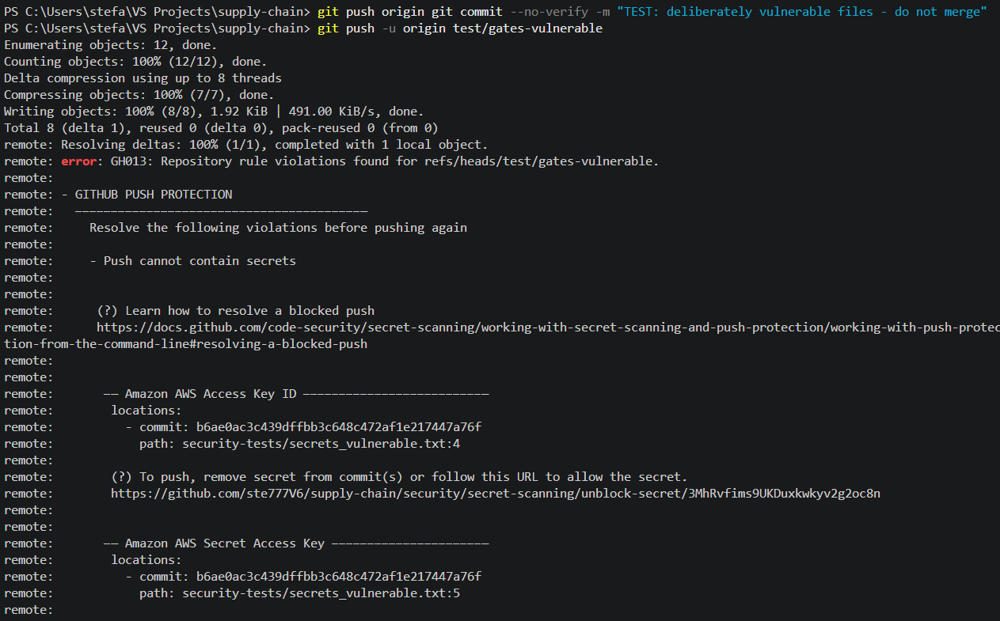
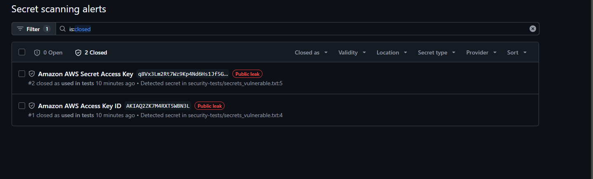
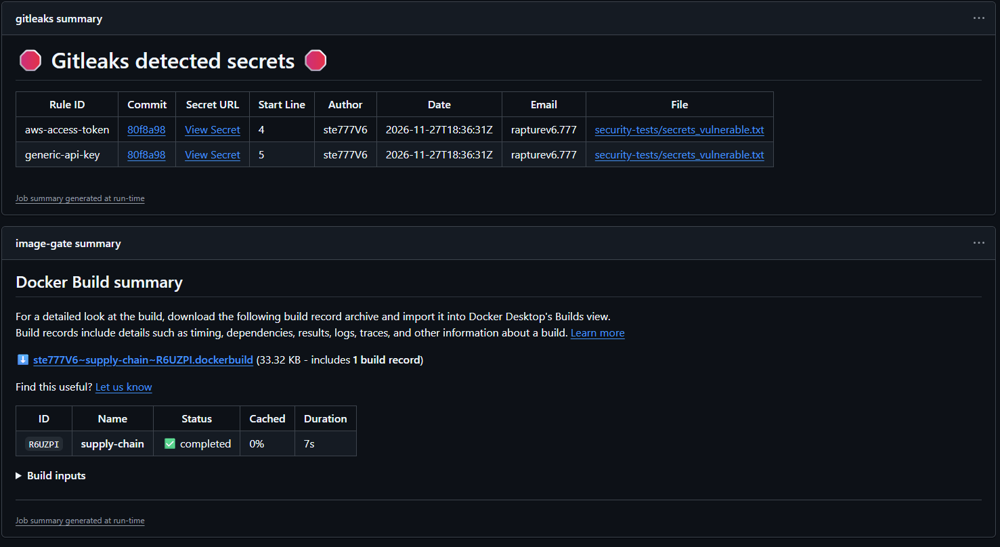
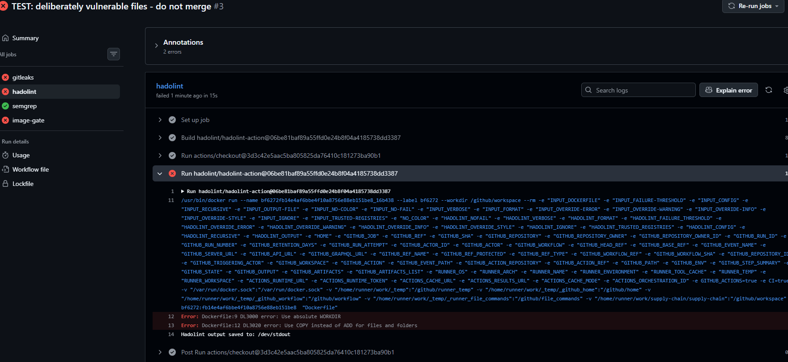
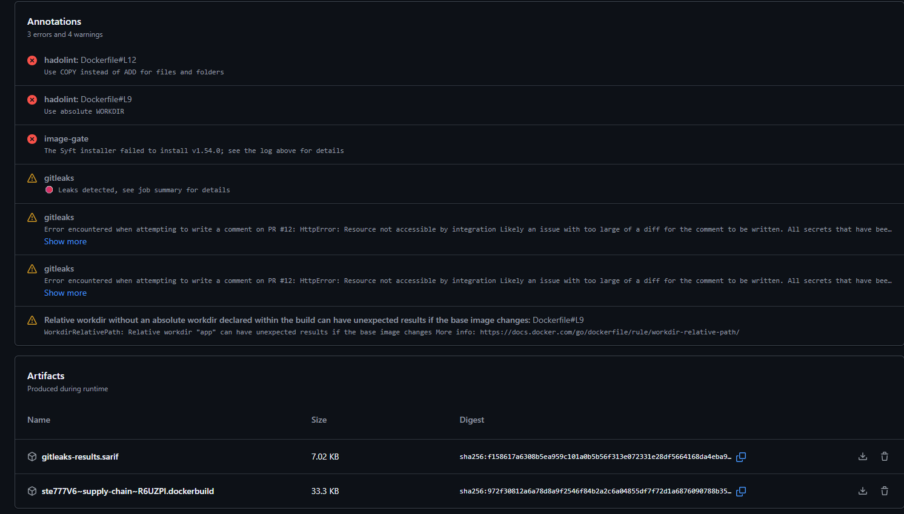
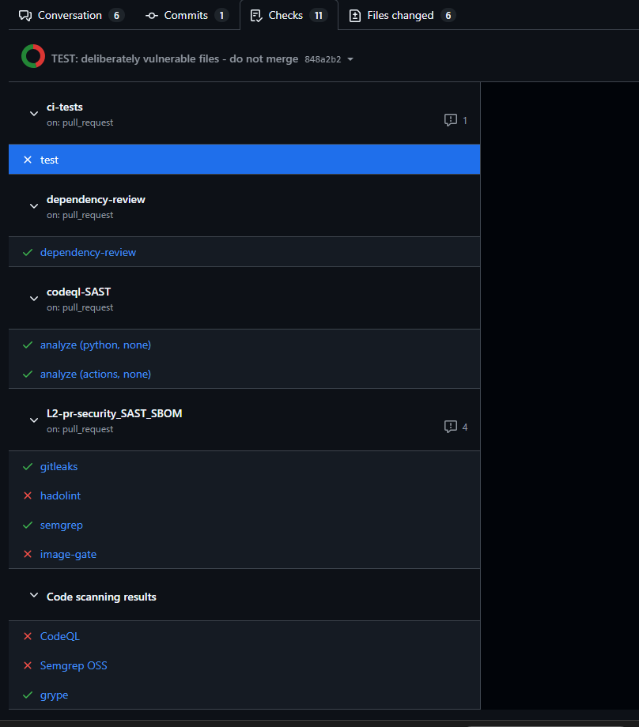
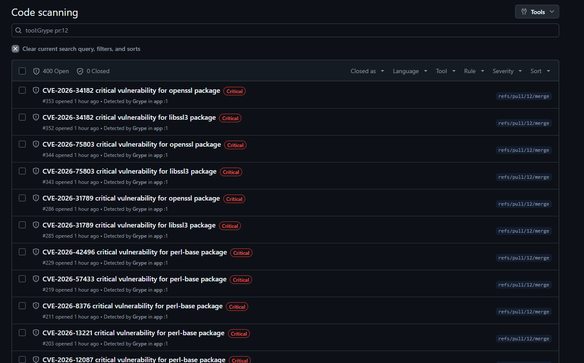
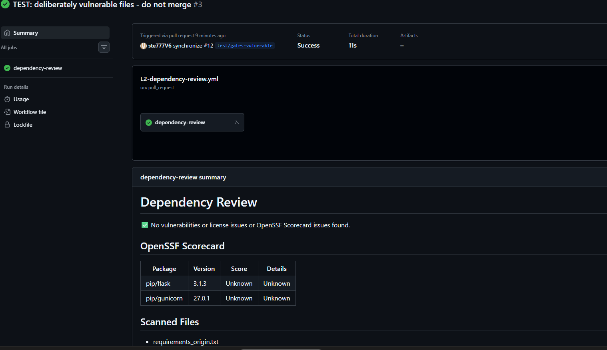
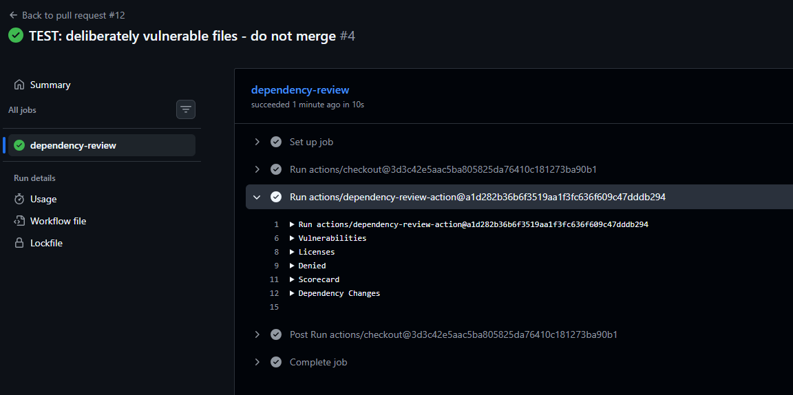

# Layer 2 — Pull request security gates

**Repository:** [ste777V6/supply-chain](https://github.com/ste777V6/supply-chain)
**Scope:** every pull request into `main`
**Status:** implemented and tested (PR #11 clean run, PR #12 vulnerable run). Two items are still open (section 8).

---

## 1. Purpose

Layer 1 (pre-commit hooks) gives quick feedback on the laptop, but anyone can skip it with `git commit --no-verify`. Layer 2 is the first layer that **cannot be skipped**. The checks run on GitHub, and a ruleset on `main` makes them required before merge.

| Layer | Where | Can be skipped? |
|---|---|---|
| 1. Commit | Laptop (pre-commit hooks) | Yes (`--no-verify`) |
| **2. Pull request** | **GitHub Actions + rulesets + push protection** | **No** (only through an audited bypass) |
| 3. Build on `main` | GitHub Actions (SBOM, signing, provenance) | No |
| 4. Admission | Kubernetes (Kyverno) | No |

---

## 2. Gates in this layer

| Gate | Tool | Checks | Blocks merge? |
|---|---|---|---|
| Secrets at push | GitHub push protection | Known provider secrets in pushed commits | Blocks the **push** (bypass needs a reason, and an alert is recorded) |
| Secrets in the PR | gitleaks (`gitleaks/gitleaks-action` v3.0.0) | Secrets in every commit in the PR | Yes (required check) |
| Dockerfile lint | hadolint (`hadolint/hadolint-action` v3.5.0) | Dockerfile best practices, threshold `error` | Yes (required check) |
| SAST (deep) | CodeQL (`security-extended`, Python + Actions) | Data-flow vulnerabilities (injection and others) | Yes, through the ruleset rule "Require code scanning results" |
| SAST (fast) | Semgrep 1.187.0 (`p/python`) | Pattern rules | No: report only (SARIF to code scanning) |
| Dependency changes | `actions/dependency-review-action` v5.0.0 | Vulnerable or denied packages added by the PR (`fail-on-severity: high`) | Yes (required check) — **see the gap in section 6.6** |
| Image vulnerabilities | Syft (SPDX JSON SBOM) + Grype | CVEs in the built image, `severity-cutoff: high`, `only-fixed` | Yes (`image-gate`, required check) |
| Repository hygiene | OpenSSF Scorecard | Repository security practices | No (score only) |

Workflow files on `main`:

```
.github/workflows/
├── L2-pr-security_SAST_SBOM.yml   # gitleaks, hadolint, semgrep, image-gate (Syft + Grype)
├── L2-codeql-SAST.yml             # CodeQL
├── L2-dependency-review.yml       # dependency review
├── L2-ci-tests.yml                # unit tests
├── scorecard-Repo_hygiene.yml     # OpenSSF Scorecard
└── supply-chain.yml               # Layer 3 (build on main)
```

Every action is pinned to a **full commit SHA**, with the version in a comment. A tag can be moved to point at malicious code; the Trivy compromise of 19 March 2026 force-pushed release tags. A SHA cannot be moved.

### 2.1 Branch protection (ruleset on `main`)

- Required status checks: `ci-tests`, `hadolint`, `image-gate`, `dependency-review`, `gitleaks`
- Require code scanning results: **CodeQL**, alerts **Errors**, security alerts **High or higher**
- Pull request required before merging

Code scanning merge protection only looks at alerts on lines the PR changes. Older alerts elsewhere in the repository do not block a PR.

---

## 3. How the image gate works

```
PR opened
  └─ docker build (load locally, not pushed)  tag local/app:pr-<sha>
       └─ Syft  -> sbom.spdx.json (SPDX 2.3)
            └─ Grype scans the SBOM
                 ├─ severity-cutoff: high  -> fail on High or Critical
                 ├─ only-fixed: true       -> ignore findings with no fix yet
                 └─ SARIF -> code scanning (category "grype")
```

**Why `only-fixed`:** a gate should only block on problems the developer can actually fix. Grype's `--only-fixed` adds ignore rules for findings whose fix state is *not-fixed*, *wont-fix* or *unknown*. That is why the log says `ignoring 371 matches due to user-provided ignore rules`. The ignored findings are not lost: they stay visible in Layer 3 and Dependency-Track for triage.

---

## 4. Test 1 — clean run (PR #11)

PR #11 (`Layer2` branch, commit `8cd98a7` "Updated L2 SAST SBOM pipeline") added the Layer 2 workflows themselves.

| Check | Result |
|---|---|
| gitleaks | ✅ passed |
| hadolint | ✅ passed |
| semgrep | ✅ passed |
| image-gate | ✅ passed (2m 22s) |

Artifacts produced: `gitleaks-results.sarif`, the SPDX JSON SBOM, and the Docker build record. Merged as `520d843`.

---

## 5. Test 2 — vulnerable run (PR #12)

### 5.1 Test files

The test branch `test/gates-vulnerable` added **deliberately vulnerable files. It must never be merged.**

| File | Planted problem | Gate that should catch it |
|---|---|---|
| `security-tests/secrets_vulnerable.txt` | Fake AWS key pair in valid format (`AKIA` + 16 base32 characters, 40-character secret) | Push protection, gitleaks |
| `security-tests/app_vulnerable.py` | Flask `request.args` passed to `subprocess.check_output(..., shell=True)`, and SQL built by string concatenation | CodeQL, Semgrep |
| `Dockerfile` | `FROM python:3.12.0-slim` (old base), `WORKDIR app` (relative), `ADD` instead of `COPY` | hadolint, Grype |
| `requirements.txt` | `requests==2.19.0` (GHSA-x84v-xcm2-53pg, High, fixed in 2.20.0), `urllib3==1.23` (GHSA-mh33-7rrq-662w, High, fixed in 1.24.2; GHSA-v845-jxx5-vc9f, High, fixed in 1.26.17) | dependency-review, Grype |

The original files were kept as `Dockerfile_origin` and `requirements_origin.txt`. Advisory IDs were checked against the GitHub Advisory Database.

### 5.2 Results

| Gate | Result | Verdict |
|---|---|---|
| Push protection | Push rejected with **GH013** | ✅ Works |
| gitleaks (CI) | Failed: 2 leaks | ✅ Works |
| hadolint | Failed: DL3000, DL3020 | ✅ Works |
| CodeQL + ruleset | Merge blocked: 1 Critical, 1 High | ✅ Works |
| Semgrep | 4 Error findings, reported only | ✅ Works as designed (does not block) |
| image-gate (Grype) | Failed: High/Critical findings | ✅ Works (first run) |
| dependency-review | **Passed — vulnerable packages missed** (4 runs) | ❌ Gap (section 6.6) |
| ci-tests | Failed (side effect of the changed files) | n/a |

---

## 6. Evidence and analysis

### 6.1 Push protection

The first push of the fake key pair was rejected on the server, even though Layer 1 had been bypassed:



To test the CI gitleaks gate as well, the push was then allowed through the audited bypass with the reason **"It's used in tests"**. GitHub recorded both secrets as alerts, closed as *used in tests*, and labelled them *Public leak* because the repository is public:



> **Correction to the Layer 1 document:** Layer 1 section 7.1 originally said push protection did not block a synthetic key. This test shows that it **does** block a key pair in the correct format. The earlier result came from a broken test: the key ID still had an invalid character or the secret had the wrong length.

### 6.2 gitleaks in CI

After the bypass, gitleaks (8.24.3) scanned the two PR commits and failed the job:

| Rule | File | Line | Commit |
|---|---|---|---|
| `aws-access-token` | `security-tests/secrets_vulnerable.txt` | 4 | `80f8a98` |
| `generic-api-key` | `security-tests/secrets_vulnerable.txt` | 5 | `80f8a98` |



The job runs with `--redact`, so secrets show as `REDACTED` in the log and SARIF. Full log: [`05c-gitleaks-ci-log.txt`](evidence/layer2/05c-gitleaks-ci-log.txt).

**Side finding:** the action also logged `Resource not accessible by integration` when it tried to post a PR comment. The action uses the automatic `GITHUB_TOKEN` to comment, and this token has only read access in the workflow. The job summary, the SARIF and the failed check already report the leak, so the comment is not needed. The fix is to turn it off instead of granting more permissions:

```yaml
env:
  GITHUB_TOKEN: ${{ secrets.GITHUB_TOKEN }}
  GITLEAKS_ENABLE_COMMENTS: false
```

### 6.3 hadolint



- `Dockerfile:9 DL3000 error: Use absolute WORKDIR`
- `Dockerfile:12 DL3020 error: Use COPY instead of ADD for files and folders`

Docker BuildKit's own build check also flagged line 9 (`WorkdirRelativePath`), which is a second, independent signal:



### 6.4 CodeQL and Semgrep

CodeQL raised **"Uncontrolled command line"** (Critical) and **"SQL query built from user-controlled sources"** (High) on `app_vulnerable.py`. The ruleset blocked the merge with *"CodeQL has detected 2 security relevant alerts blocking this code from being merged."*

Semgrep found the same issues with 4 Error-level rules (`subprocess-injection`, `dangerous-subprocess-use` and others). They were uploaded to code scanning without blocking, as designed.



Full PR page text: [`04-pr-12-conversation-and-merge-box.txt`](evidence/layer2/04-pr-12-conversation-and-merge-box.txt).

### 6.5 Image gate (Syft + Grype)

First run log ([`07-image-gate-grype-log.txt`](evidence/layer2/07-image-gate-grype-log.txt)):

```
grype version: 0.118.0
using distro: debian 12.2
gathered packages packages=129
ignoring 371 matches due to user-provided ignore rules
ERROR discovered vulnerabilities at or above the severity threshold
```

Grype uploaded **400 open alerts** for `pr:12`, all with a fix available. Most top findings are **Critical OS packages from the old base image** (`openssl`, `libssl3`, `perl-base` in Debian 12.2), not the Python code:



**Lesson:** pinning an old base image patch version (`python:3.12.0-slim`) adds hundreds of fixable CVEs. Base images must be kept current, by Dependabot updates and ideally by digest pinning.

### 6.6 Gap — dependency-review missed the vulnerable packages

The PR diff clearly changes `requirements.txt` (flask/gunicorn replaced by `requests==2.19.0` and `urllib3==1.23`). Yet dependency-review passed **four times**, and each time **Scanned Files** listed only `requirements_origin.txt`:





Logs: [`05-dependency-review-log.txt`](evidence/layer2/05-dependency-review-log.txt), [`06-dependency-review-rerun-summary.txt`](evidence/layer2/06-dependency-review-rerun-summary.txt).

**What GitHub's documentation says** (checked 27 Nov 2026):

- Since April 2026, Python dependency graphs are built by **Dependabot graph jobs**, which upload a snapshot through the Dependency Submission API (changelog *"Dependabot-based dependency graphs for Python"*).
- The dependency graph shows only one instance of each manifest file. Graph-job data takes precedence over static analysis, and *"Static analysis results are used when no other data is available."*
- Dependency review compares the PR's dependency changes with the state at the HEAD commit of the target branch.
- The docs do **not** say whether graph jobs run for PR branches, or how dependency review gets Python data for a PR.

**Leading hypothesis (not proven):**

1. `requirements.txt` on `main` is covered by a graph-job snapshot.
2. No snapshot exists for the PR's head commit, so dependency review sees no change in `requirements.txt`.
3. `requirements_origin.txt` is a new path with no snapshot, so it falls back to static parsing. That is why it is the only file scanned.

**Alternative hypothesis:** the test commit renamed the original `requirements.txt` and created a new one in the same commit, which may confuse the manifest diff.

**Test to tell them apart (pending):** a separate branch from `main` that changes only one line of `requirements.txt` (`requests==2.19.0`).

| Outcome | Conclusion |
|---|---|
| dependency-review fails | The rename in PR #12 caused the miss |
| dependency-review passes | Snapshot gap: this check is not reliable for Python PRs in this setup |

Supporting checks: Insights → Dependency graph (detection source of `requirements.txt`); the Actions tab (do Dependabot graph runs exist for PR branches?); the expanded *Dependency Changes* section of the job log.

**Defence in depth:** Grype scans the built image, so it is a second layer for Python packages. Whether it reported `requests` and `urllib3` still has to be confirmed (section 8).

---

## 7. Lessons learned

- **Server-side controls work even when local hooks are skipped.** Push protection blocked the key at push time, and gitleaks blocked it again in CI after an audited bypass.
- **Bypasses must leave a trail.** The "used in tests" reason and the closed alerts are the audit record.
- **Test data must have a valid format.** A key ID with a character outside base32, or a secret of the wrong length, is ignored by detectors. A test that "passes" with impossible data proves nothing.
- **Never rely on one tool per risk.** dependency-review missed the vulnerable packages; Grype, hadolint and BuildKit gave overlapping signals elsewhere.
- **A failed job is not always a failed gate.** One image-gate run failed while installing Syft, before any scan. Infrastructure failures must be re-run and must not be reported as security results.
- **Old base images dominate the CVE count.** Hundreds of fixable findings came from Debian 12.2 packages, not the application.
- **Grant the least permissions.** The gitleaks PR comment needs write access that isn't needed; the comment is turned off instead.
- **Pin by SHA, and check what a SHA points to.** One hadolint SHA picked from an alphabetical `git ls-remote` list was v1.0.0, not the latest version.
- **Keep the local base up to date.** A test branch created from a stale local `main` had the old workflow names; `git pull` before branching, and `git stash` before any `reset --hard`.

---

## 8. Open items

| # | Item | Status |
|---|---|---|
| 1 | Re-run `image-gate`. The latest run failed while installing Syft v1.54.0, before scanning. Root cause not yet confirmed. | Pending |
| 2 | Search code scanning for `tool:Grype pr:12 requests` and `urllib3` to confirm Grype caught the Python packages | Pending |
| 3 | Run the isolated `requirements.txt` test for dependency-review (section 6.6) | Pending |
| 4 | Add `GITLEAKS_ENABLE_COMMENTS: false` on `main` | Pending |
| 5 | Add a non-failing Grype **table** output step for readable logs | Pending |
| 6 | If the snapshot gap is confirmed: add a source-level Python dependency scanner to the PR workflow | Pending |
| 7 | Clean up: close PR #12 **unmerged**, delete `test/gates-vulnerable`, close the remaining code scanning alerts as *used in tests* | After items 1–3 |

---

## 9. References

- GitHub Docs — [Dependency graph data](https://docs.github.com/en/code-security/concepts/supply-chain-security/dependency-graph-data)
- GitHub Changelog — [Dependabot-based dependency graphs for Python (23 Apr 2026)](https://github.blog/changelog/2026-04-23-dependabot-graphs-for-python)
- GitHub Docs — [Dependency graph supported package ecosystems](https://docs.github.com/en/code-security/supply-chain-security/understanding-your-software-supply-chain/dependency-graph-supported-package-ecosystems)
- [gitleaks-action README](https://github.com/gitleaks/gitleaks-action) (`GITLEAKS_ENABLE_COMMENTS`)
- [anchore/sbom-action releases](https://github.com/anchore/sbom-action/releases)
- [GitHub Advisory Database](https://github.com/advisories): GHSA-x84v-xcm2-53pg, GHSA-mh33-7rrq-662w, GHSA-v845-jxx5-vc9f
